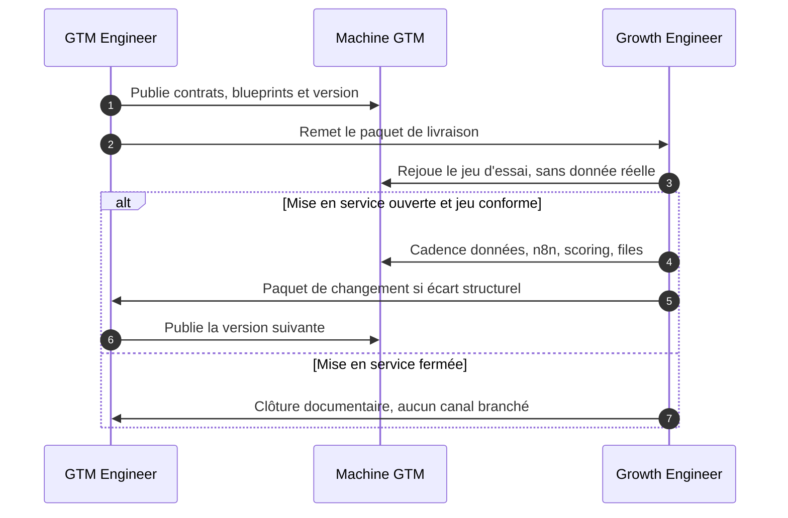

# Workflows opératoires GTM

Auteur : Didier Lioniello.

Deux rôles, une seule machine go-to-market. Ils sont complémentaires. Ils ne sont pas synonymes.

| Rôle | Verbe | Ce qu’il fait | Ce qu’il ne fait pas |
| --- | --- | --- | --- |
| **GTM Engineer** | **Construire** | Conçoit et livre la machine : périmètre, dictionnaire, canaux, scoring, flux n8n, jeu d’essai, paquet de livraison. | Ne tient pas la cadence quotidienne. Ne corrige pas les files à la place de l’exploitation. |
| **Growth Engineer** | **Faire tourner** | Exécute la cadence : données, automatisation n8n, contrôle du scoring, acquisition sur les canaux déjà branchés, journal, files humaines. | Ne change pas un seuil, un champ, un canal ni un flux. Il renvoie un paquet de changement. |

La machine **classe et dépose dans une file**. En version `2026.11.0`, elle n’écrit à personne et ne relance personne. Toute action vers un lead est humaine.

## Comment les deux workflows s’emboîtent

Le GTM Engineer publie une version. Le Growth Engineer la rejoue sur le jeu d’essai, puis la fait tourner. Dès qu’un écart vient de la machine (règle, champ, canal, panne répétée), le Growth Engineer arrête le contournement et renvoie la main.



Lecture des procédures :

- construire : [workflows/gtm-engineer.md](workflows/gtm-engineer.md)
- faire tourner : [workflows/growth-engineer.md](workflows/growth-engineer.md)
- vocabulaire : [glossaire.md](glossaire.md)

## Semaine type

Les horaires sont le cadre de travail de la version `2026.11.0`. Les changer est une décision du GTM Engineer, écrite dans le paquet de livraison.

| Quand | GTM Engineer | Growth Engineer |
| --- | --- | --- |
| Chaque jour ouvré, en début de journée | Rien, sauf écart structurel bloquant reçu la veille | Séquence quotidienne, puis clôture écrite |
| Mardi, 30 minutes | Écoute, puis tranche chaque demande | Présente le paquet hebdomadaire, y compris « aucun changement » |
| Premier mardi du mois, 60 minutes à la place du point de 30 minutes | Revue de la machine et versions du mois suivant | Bilan d’exploitation du mois |

## Carte du dépôt

```text
README.md                         vue d’ensemble, distinction, semaine type
LICENSE                           MIT
glossaire.md                      termes utilisés par les deux rôles
workflows/gtm-engineer.md         procédure de construction
workflows/growth-engineer.md      procédure d’exploitation
contrats/perimetre-offre.md       qui est dans la cible, qui est exclu
contrats/dictionnaire-donnees.md  champs, statuts, précédence des sources
contrats/contrat-scoring.md       rejets, points, seuils, version de score
contrats/contrat-canaux.md        entrées autorisées et champs obligatoires
contrats/jeu-essai.md             fiches fictives et routes attendues
contrats/paquet-livraison.md      ce que le GTM remet, et l’état v0
contrats/paquet-changement.md     ce que Growth renvoie
contrats/journal-cloture.md       schéma de la clôture quotidienne
blueprints/capture-et-normalisation.md
blueprints/scoring-et-routage.md
blueprints/journal-et-files.md
```

Les blueprints sont des plans de construction pour n8n. Ce ne sont pas des exports JSON. Aucun flux de ce dépôt n’a été importé ni exécuté.

## Ordre de lecture pour exécuter

1. Lire le tableau ci-dessus et le glossaire.
2. Lire le workflow du rôle tenu aujourd’hui, du début à la fin, sans sauter la séquence.
3. Garder ouverts le dictionnaire, le contrat de scoring, le contrat de canaux et le jeu d’essai : ce sont les seules règles de calcul.
4. Avant toute donnée réelle, lire l’état des cases dans le [paquet de livraison](contrats/paquet-livraison.md). En `2026.11.0`, la mise en service est fermée.

## Ce que ce dépôt est

Documentation opératoire. Les contrats `2026.11.0` sont complets : un lecteur peut les appliquer à la main sur le jeu d’essai et tenir la cadence documentaire (clôture « aucun canal branché »).

Outils : n8n est la colonne d’automatisation. Le CRM, l’email, l’enrichissement, l’acquisition et le support du journal restent interchangeables. Aucun éditeur n’est choisi ici. Les secrets d’accès restent dans le coffre de l’instance n8n, jamais dans git.

## Limites

- Aucune connexion, aucun secret, aucune donnée personnelle.
- Aucun volume, coût, taux de conversion ou résultat commercial n’est fourni : ce dépôt ne contient pas d’historique d’exploitation.
- Le scoring v0 est une grille de mots et de champs, recalculable à la main. Ce n’est pas un modèle statistique.
- Les fiches du jeu d’essai sont fictives. Le domaine `exemple.test` ne désigne personne.
- L’unit economics et les tableaux de forecast ne sont pas dans ce dépôt. Le démonstrateur séparé [RevenueOps-360](https://github.com/didier-lioniello/RevenueOps-360) traite ce sujet sur données synthétiques.
- Deux blueprints n8n publics existent à côté, sur d’autres sujets : [qualification et rendez-vous](https://github.com/didier-lioniello/agent-qualification-leads-rdv), [veille concurrentielle](https://github.com/didier-lioniello/veille-concurrentielle-ia). Ils ne sont pas branchés ici.

## Licence

MIT. Voir [LICENSE](LICENSE).
