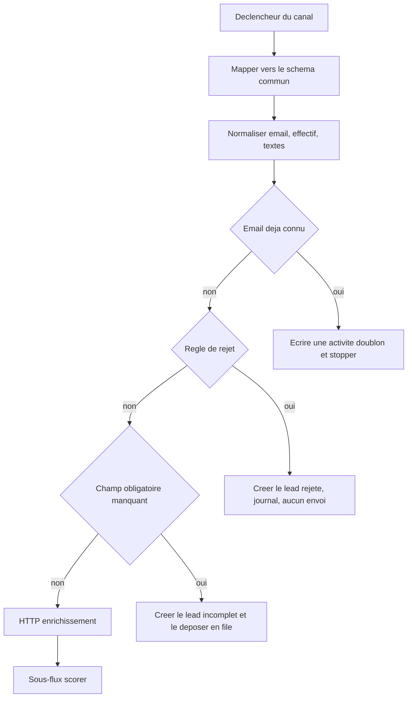

# Blueprint : capture et normalisation

Version `2026.11.0`. Auteur : Didier Lioniello.

Plan de construction pour n8n. Ce n’est pas un export JSON. Aucun flux décrit ici n’a été importé ni exécuté. Les listes de mots et l’ordre de décision restent dans le [contrat de scoring](../contrats/contrat-scoring.md). On ne les recopie pas dans les notes de nœuds.

Secrets : coffre n8n uniquement. Aucune URL signée dans le nom du workflow.

## Forme

Un workflow par canal, plus un sous-flux unique `decider`.

| Workflow | Déclencheur | Canal écrit par la machine |
| --- | --- | --- |
| `canal-formulaire-site` | Webhook, ou formulaire natif n8n | `formulaire_site` |
| `canal-email-entrant` | Déclencheur email de la boîte dédiée | `email_entrant` |
| `canal-import-manuel` | Dépôt du fichier décrit dans le [contrat de canaux](../contrats/contrat-canaux.md) | `import_manuel` |
| `canal-acquisition-payante` | Webhook ou fichier, avec les trois UTM | `acquisition_payante` |

Tant que `branche = non`, le workflow de ce canal n’est pas activé. Le créer inactif, lors de l’étape 8 du [workflow GTM](../workflows/gtm-engineer.md), est permis. L’activer sans case `mise_en_service = oui` ne l’est pas.

Chaque workflow de canal ne fait que trois choses : recevoir, mapper vers le schéma commun, appeler `decider`. La règle ne vit pas dans le canal. Sinon une correction de scoring devra être répétée quatre fois, et les copies divergeront.

## Schéma commun en entrée de `decider`

`canal`, `email`, `prenom`, `nom`, `societe`, `pays`, `effectif`, `titre`, `message`, `utm_source`, `utm_medium`, `utm_campaign`, `recu_le`.

Les champs absents arrivent vides. On n’y met pas de valeur par défaut.

L’enrichissement en échec continue vers `scorer`. Il ne doit pas y avoir de branche « stopper si l’API ne répond pas ».

## Nœuds du sous-flux `decider`

1. **Code, normaliser.** Appliquer les étapes 1 à 6 du contrat de scoring. Ne pas scorer dans ce nœud.
2. **CRM, rechercher par email normalisé.** Le connecteur n’est pas choisi dans cette version. Le nœud s’appelle fonctionnellement « recherche CRM ». Zéro résultat : pas un doublon. Une erreur HTTP du CRM : échec de l’exécution, pas un « pas de doublon ».
3. **Si doublon.** Écrire une activité sur le lead trouvé. Statut de l’entrée `doublon`. Fin du flux pour cette entrée. Ne pas rappeler le scoring du lead existant. Pas de ligne dans l’objet `decision` : le dictionnaire n’en prévoit pas pour un doublon.
4. **Code, rejets.** Ordre du contrat : candidature, fournisseur, pays, effectif. Première règle vraie : `statut = rejete`, `motif_rejet` rempli, pas de score.
5. **Si rejet.** Créer le lead, écrire la décision avec `ordre = rejet`. Fin du flux. Aucun nœud email.
6. **Code, champs obligatoires.** Liste du contrat de canaux pour `canal`. Manque : `statut = incomplet`, `champs_manquants` rempli, pas de score.
7. **Si incomplet.** Créer le lead avec `champs_manquants` rempli et `score_valeur` vide, puis stocker `statut = en_attente`. Écrire la décision avec `ordre = incomplet`. La décision reste lisible par `champs_manquants`, pas par une route. Fin du flux. Aucun nœud email pour réclamer le champ.
8. **HTTP, enrichissement.** Optionnel. Délai maximum : 10 secondes. Une nouvelle tentative seulement sur 408, 429, 500, 502, 503, 504. Ensuite, succès ou échec, on continue. En échec : laisser les champs vides et poursuivre. En succès : remplir seulement société, pays, effectif, secteur, site si le champ du lead est vide. Si les deux valeurs existent et diffèrent : garder le lead, `conflit_enrichissement = oui`.
9. **Appeler** le sous-flux [scoring et routage](scoring-et-routage.md).

`donnees_partielles` se calcule après l’étape 8, avant l’appel au scoring : `oui` si société, pays, effectif ou titre est vide.

## Rejeu du jeu d’essai

Lors du `replay_n8n`, l’étape 8 est forcée en échec, sans appel réel à une API. La base ne contient aucune adresse `@exemple.test` au départ. Les issues attendues sont celles du [jeu d’essai](../contrats/jeu-essai.md). Un enrichissement réel pendant ce rejeu invalide la comparaison.

## Erreurs

| Situation | Comportement |
| --- | --- |
| Échec CRM, code transitoire | L’exécution reste en erreur. Le Growth Engineer pourra la relancer une fois |
| Échec CRM, autre code | Erreur structurelle. Pas de lead « à moitié » : si la création a échoué, rien ne doit apparaître comme `route_*` |
| Échec enrichissement | Pas une erreur d’exécution. Flag de données partielles si les champs restent vides |
| Exception du nœud Code | Erreur structurelle. Le journal d’erreur reçoit `execution_id` et le nom du workflow, pas le message du lead |

Le workflow d’erreur est dans le [blueprint journal](journal-et-files.md).
