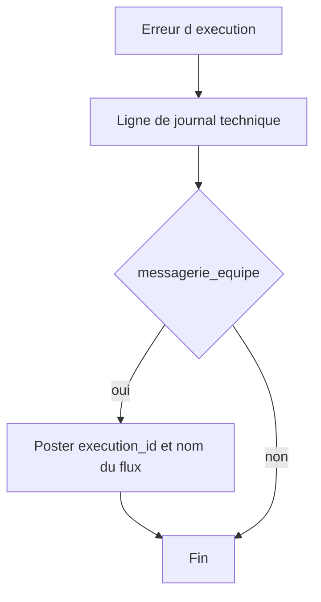

# Blueprint : journal et files

Version `2026.11.0`. Auteur : Didier Lioniello.

Plan de construction pour n8n. Ce n’est pas un export JSON. Aucun flux décrit ici n’a été importé ni exécuté.

Deux automatismes, et une limite nette : la clôture quotidienne reste un acte du Growth Engineer. La machine ne se déclare pas elle-même en règle.

## Flux `erreur-execution`

Déclencheur : erreur d’exécution n8n.

1. Lire le nom du workflow, `execution_id`, le code d’erreur s’il existe, l’horodatage.
2. Écrire une ligne dans le journal technique : ces champs, plus `classe` vide. La classe transitoire ou structurelle est posée par le Growth Engineer dans la séquence quotidienne, pas par ce flux. Le flux ne relance pas.
3. Si `messagerie_equipe = oui` dans le paquet : poster dans le canal interne le nom du workflow et `execution_id`. Rien d’autre. Pas de charge utile du lead.
4. Si la case vaut `non` : s’arrêter après le journal. C’est l’état de `2026.11.0`.

Durée de ces lignes : 90 jours, comme le [dictionnaire](../contrats/dictionnaire-donnees.md). Le flux n’efface pas au-delà : une suppression planifiée est une version à part, à écrire quand le support de journal est choisi. Tant que le support vaut `non choisi`, le Growth Engineer n’accumule pas ces lignes dans git.

## Flux `rappel-cloture`

Déclencheur : planifié, chaque jour ouvré, avant le début de journée utilisé par le Growth Engineer.

1. Créer une tâche « clôture du jour » avec la date.
2. Ne pas la marquer faite.
3. Ne pas écrire la ligne de clôture. Les colonnes du [journal](../contrats/journal-cloture.md) exigent un jugement sur les erreurs et les files. Ce jugement n’est pas un cron.

Si l’instance n8n n’existe pas, ce rappel n’existe pas non plus. La clôture documentaire se fait quand même, à la main, dans le tableur hors git.

## Files humaines

Pas un troisième flux. Une vue, dans le CRM ou la table :

| Vue | Filtre | Ordre de traitement |
| --- | --- | --- |
| À traiter | `statut = en_attente` | `champs_manquants` rempli, puis `route_eleve`, puis `route_moyen`, puis `route_faible` |
| Rejets du jour | `statut = rejete` et `cree_le` dans la fenêtre | Échantillon de contrôle, pas de démarche |
| Doublons du jour | activités `doublon` | Vérifier que le lead d’origine n’a pas été rescoré |

La vue n’envoie rien. Passer une fiche à `traite` est un geste humain, dans l’outil, pendant la séquence quotidienne.

## Ce que ces flux ne font pas

- Ils ne calculent pas le score.
- Ils ne relancent pas une exécution.
- Ils ne ferment pas la journée.
- Ils ne compensent pas un canal `branche = non` par un import.
- Ils ne stockent pas le corps du message dans la ligne d’erreur.
