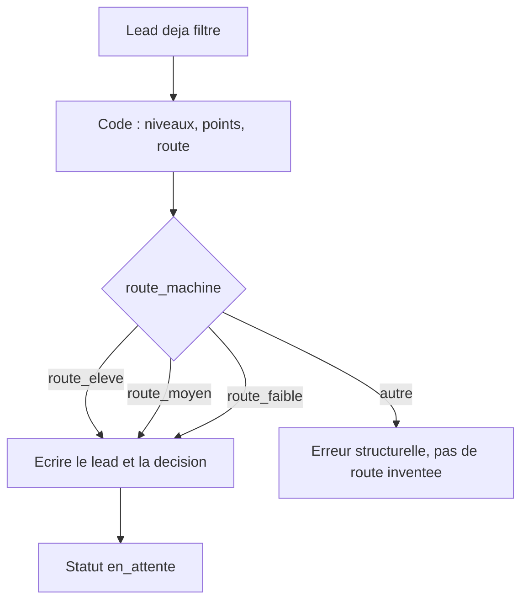

# Blueprint : scoring et routage

Version `2026.11.0`. Auteur : Didier Lioniello.

Plan de construction pour n8n. Ce n’est pas un export JSON. Aucun flux décrit ici n’a été importé ni exécuté.

Le sous-flux `scorer` ne s’appelle que pour un lead qui a déjà passé le doublon, les rejets et les champs obligatoires. Voir [capture et normalisation](capture-et-normalisation.md).

La grille n’est pas redéfinie ici. Le nœud Code implémente le [contrat de scoring](../contrats/contrat-scoring.md) de la même version, y compris les frontières de mots et le repli des apostrophes. Un modèle de langage n’est pas dans ce sous-flux.

## Entrée

Le lead normalisé, plus `donnees_partielles`, `conflit_enrichissement`, `version_machine`, `execution_id`.

## Nœuds

1. **Code, scorer.** Calculer les quatre niveaux, les points, `score_valeur`, `detail_score`, `route_machine`. `score_version` = version du contrat, pas la date du jour. Refuser de s’exécuter si `motif_rejet` ou `champs_manquants` est déjà rempli : ce serait un appel illégal, à traiter comme une erreur structurelle.
2. **Aiguillage** sur `route_machine`. Trois sorties : `route_eleve`, `route_moyen`, `route_faible`. Une quatrième sortie, « autre », écrit une erreur structurelle et ne crée pas de route improvisée.
3. **CRM, créer ou mettre à jour** avec les champs du [dictionnaire](../contrats/dictionnaire-donnees.md). `route_humaine` et `motif_humain` restent vides. Ne pas écraser un `score_valeur` déjà présent sur ce `lead_id` : ce sous-flux crée le score, il ne le rejoue pas.
4. **Journal de décision.** Une ligne : `lead_id`, `score_version`, `ordre = score`, `detail_score`, `route_machine`, `execution_id`. Pas le message.
5. **File.** Écrire `statut = en_attente`. La décision reste dans `route_machine`. La file est une vue du CRM, ou une table, filtrée par `statut = en_attente` et triée comme le [workflow Growth](../workflows/growth-engineer.md) : `champs_manquants` rempli, puis `route_eleve`, puis `route_moyen`, puis `route_faible`. Le sous-flux ne trie pas lui-même au-delà de l’écriture du statut.
6. **Fin du flux.** Pas de nœud d’email, pas de nœud de calendrier, pas de nœud de messagerie vers l’extérieur.

## Ce que le Growth Engineer contrôle

- `detail_score` se relit à la main avec le contrat.
- `score_version` égale la version publiée.
- Aucune exécution de `scorer` ne produit d’envoi.
- Une route hors des trois valeurs n’apparaît pas dans le CRM : elle apparaît comme erreur.

## Hors de ce blueprint

- Réponse au lead, même « pour les scores élevés ».
- Prise de rendez-vous.
- Reprise de l’historique lors d’un changement de grille.
- Notation par un modèle de langage, y compris « pour aider » le nœud Code.

Ces ajouts sont des versions nouvelles, avec jeu d’essai nouveau. Le GTM Engineer les construit. Le Growth Engineer ne les active pas depuis l’éditeur n8n.
