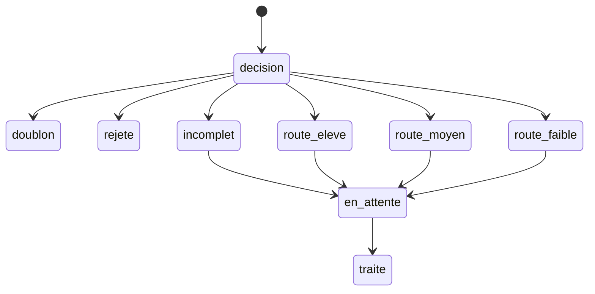

# Dictionnaire de données

Version `2026.11.0`. Auteur : Didier Lioniello.

Les noms de champs sont en ASCII, sans accent, pour passer tels quels dans n8n et dans un CRM. Les statuts et les motifs forment des listes fermées : une valeur absente de la liste est un écart structurel.

## Objet `lead`

Une ligne par email normalisé.

| Champ | Obligatoire | Valeurs | Règle |
| --- | --- | --- | --- |
| `lead_id` | oui | identifiant stable produit par la machine | Ne pas réutiliser un identifiant, même après rejet |
| `version_machine` | oui | `2026.11.0` pour cette publication | Copiée depuis le paquet de livraison au moment du traitement |
| `cree_le` | oui | date-heure ISO 8601 avec fuseau | Heure de création dans la machine, pas la date déclarée par le lead |
| `canal` | oui | voir [contrat de canaux](contrat-canaux.md) | Valeur hors liste : écart structurel, lead non scoré |
| `utm_source` | selon canal | texte court | Obligatoire seulement pour `acquisition_payante` |
| `utm_medium` | selon canal | texte court | Idem |
| `utm_campaign` | selon canal | texte court | Idem |
| `email` | oui, sauf si le rejet intervient avant | adresse normalisée | Trim, minuscules. Vide ⇒ `incomplet` si les rejets précédents n’ont pas déjà tranché |
| `prenom` | non | texte | Ne pas déduire un prénom depuis l’adresse |
| `nom` | non | texte | Idem |
| `societe` | non | texte | Vide ⇒ `donnees_partielles = oui` |
| `pays` | non | texte normalisé | Vide ⇒ pas de rejet pays, cible à 0, données partielles |
| `effectif` | non | entier ou vide | Premier entier trouvé dans la valeur brute. Sinon vide |
| `titre` | non | texte | Vide ⇒ rôle 0 et données partielles |
| `message` | selon canal | texte | Obligatoire pour `formulaire_site` et `email_entrant` |
| `secteur` | non | texte | Informatif en v0. N’entre pas dans le score |
| `site_societe` | non | URL | Renseigné seulement par l’enrichissement, si le champ était vide |
| `donnees_partielles` | oui | `oui` ou `non` | `oui` si société, pays, effectif ou titre est vide après enrichissement |
| `conflit_enrichissement` | oui | `oui` ou `non` | `oui` si l’API proposait une valeur différente d’une valeur déjà fournie par le lead. On garde la valeur du lead |
| `motif_rejet` | si rejet | `candidature`, `fournisseur`, `hors_cible_pays`, `hors_cible_effectif` | Vide sinon |
| `champs_manquants` | si incomplet | liste des noms de champs | Vide sinon |
| `score_valeur` | si scoré | entier de 0 à 100 | Vide si rejet, doublon ou incomplet |
| `score_version` | si scoré | `2026.11.0` | Ne pas réécrire le score d’un lead quand la version change |
| `detail_score` | si scoré | `cible:N;role:N;besoin:N;timing:N` | N est le niveau 0, 1 ou 2, pas les points |
| `route_machine` | si scoré | `route_eleve`, `route_moyen`, `route_faible` | Issue de la grille. Ne jamais l’écraser |
| `route_humaine` | non | une route, ou vide | Décision d’une personne. N’efface pas `route_machine` |
| `motif_humain` | si route humaine | texte court, sans copier le message entier | Obligatoire dès que `route_humaine` est rempli |
| `statut` | oui | liste fermée ci-dessous | |
| `crm_id` | non | identifiant retourné par le CRM | Vide tant que l’écriture CRM n’a pas réussi |
| `execution_id` | oui | identifiant d’exécution n8n, ou `manuel` | `manuel` uniquement pour le recalcul papier du jeu d’essai |

### Statuts

| Statut | Sens | Suite autorisée |
| --- | --- | --- |
| `doublon` | Activité rattachée à un lead existant. Pas une nouvelle fiche | Terminé pour cette entrée |
| `rejete` | Sorti par une règle du contrat, avant le score | Terminé. Contrôle par échantillon, pas de démarche commerciale |
| `incomplet` | Champ obligatoire du canal manquant | `en_attente` |
| `route_eleve` | Score ≥ 70 | `en_attente` |
| `route_moyen` | Score de 40 à 69 | `en_attente` |
| `route_faible` | Score &lt; 40 | `en_attente` |
| `en_attente` | Déposé dans une file humaine | `traite` |
| `traite` | Une personne a fermé la fiche | Terminé |

Le nœud `decision` n’est pas un statut stocké. C’est l’ordre du contrat de scoring.

À la fin du flux, une décision `incomplet` ou une route laisse `statut = en_attente`. La décision elle-même reste lisible : `champs_manquants` pour l’incomplet, `route_machine` pour le score, et l’objet `decision`. On ne cherche donc pas `statut = incomplet` dans la file du matin : on cherche `en_attente`, puis on classe avec ces champs. `rejete` et `doublon` ne passent pas en file.

## Objet `activite`

Une ligne par entrée, y compris les doublons.

| Champ | Règle |
| --- | --- |
| `activite_id` | Identifiant stable |
| `lead_id` | Lead créé ou lead déjà connu |
| `canal` | Canal de cette entrée |
| `recu_le` | Date-heure de l’entrée |
| `resume` | 200 caractères maximum, rédigé par la machine à partir du message, ou le message lui-même s’il est plus court. Ne pas coller cette colonne dans git |

## Objet `decision`

Une ligne par lead **créé** (pas pour un doublon). Sert au recalcul.

| Champ | Règle |
| --- | --- |
| `lead_id` | |
| `score_version` | |
| `ordre` | `rejet`, `incomplet` ou `score` | Le doublon n’a pas de ligne ici : il est porté par l’activité |
| `motif` | Motif de rejet, champs manquants, ou `detail_score` |
| `route_machine` | Vide si pas de score |
| `execution_id` | |

## Précédence des sources

1. Valeur déjà présente dans l’entrée du lead (formulaire, email, import, paramètres UTM).
2. Valeur d’enrichissement, seulement si le champ du lead est vide.
3. Si les deux existent et diffèrent : garder le lead, `conflit_enrichissement = oui`.

Personne ne « corrige » un score en le remplaçant. Un désaccord humain s’écrit dans `route_humaine` et `motif_humain`. Un désaccord de calcul se traite en paquet de changement.

## Conservation

| Donnée | Durée de la version documentaire | Où |
| --- | --- | --- |
| Contrats, jeu d’essai, blueprints | Vie du dépôt git | Ce dépôt. Aucune donnée personnelle |
| Journal technique d’exécution (identifiant, statut, code d’erreur) | 90 jours | Outil de journal, hors git |
| Fiche lead et message | 24 mois après `cree_le`, puis suppression ou anonymisation | CRM ou base retenue à la mise en service |

La durée de 24 mois est la règle **documentaire**. La case « conservation confirmée » du paquet de livraison doit valoir `oui` avant la première donnée personnelle réelle. Tant qu’elle vaut `non`, la durée n’autorise pas l’ingestion réelle : elle fixe seulement le chiffre qui devra être confirmé ou remplacé par une nouvelle version.

## Interdictions d’écriture

- Pas de message de lead, d’adresse email réelle ni de nom réel dans git.
- Pas de secret d’accès, de jeton, d’URL de webhook signée ni d’en-tête d’autorisation dans le dépôt, les blueprints ou le journal copié en exemple.
- Le jeu d’essai n’utilise que le domaine `exemple.test`.
