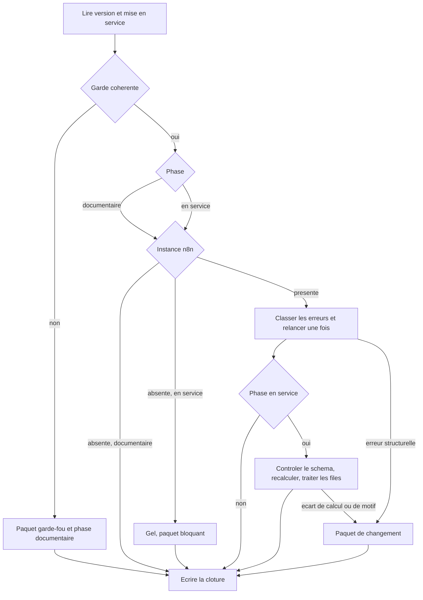
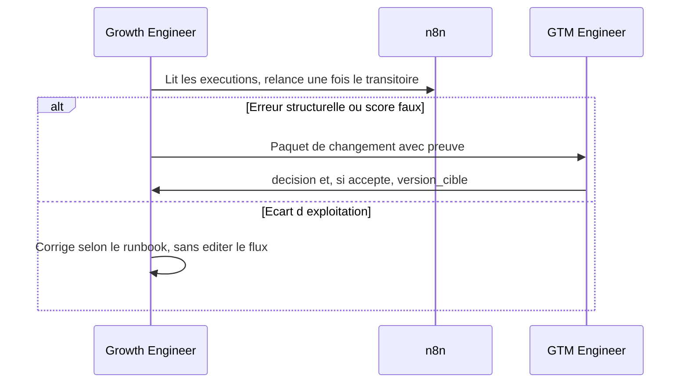

# Workflow opératoire du Growth Engineer

Version `2026.11.0`. Auteur : Didier Lioniello.

Le Growth Engineer **fait tourner** la machine go-to-market : données, automatisation n8n, contrôle du scoring, acquisition sur les canaux déjà branchés. Il ne la reconstruit pas. Un seuil, un champ, un canal ou un nœud se change uniquement par une version du [GTM Engineer](gtm-engineer.md).

En `2026.11.0`, `mise_en_service = non` et aucun canal n’est branché. La cadence existe quand même. Elle tient la phase documentaire. Elle ne fabrique pas de volume.

## Objet

Chaque jour ouvré, savoir dans quelle phase est la machine, traiter ce que la version autorise, écrire une clôture, et renvoyer au GTM Engineer ce qui relève de la machine plutôt que de l’exploitation.

## Entrées

| Entrée | Source |
| --- | --- |
| Paquet de livraison de la version en vigueur | [paquet-livraison.md](../contrats/paquet-livraison.md) |
| Dictionnaire, canaux, scoring, jeu d’essai | Contrats de la même version |
| Exécutions n8n | Instance, si elle existe. Elle n’est pas revendiquée par cette publication |
| Leads et activités | CRM ou table nommée dans le paquet. Aucun en phase documentaire |
| Export de canal | Outil d’acquisition, de formulaire ou boîte email du canal, seulement si `branche = oui` |
| Demandes déjà ouvertes | Journal hors git |

## Sorties

| Sortie | Destinataire |
| --- | --- |
| Ligne de [clôture](../contrats/journal-cloture.md) | Journal d’exploitation, hors git |
| Files passées à `traite`, ou laissées `en_attente` avec un motif | CRM ou table, en phase en service seulement |
| Revue hebdomadaire et revue mensuelle | Journal, puis créneau du GTM Engineer |
| [Paquet de changement](../contrats/paquet-changement.md) | GTM Engineer |
| Refus de réception d’une version | GTM Engineer, avec la fiche du jeu qui diverge |

## Outils

| Besoin | Outil | Règle |
| --- | --- | --- |
| Savoir quelle règle appliquer | Dépôt des contrats | En cas de contradiction entre un message et un fichier, le fichier gagne |
| Exécutions et relance | n8n, vue des exécutions | Relancer est permis. Modifier un nœud ne l’est pas |
| Fiches | Connecteur nommé dans le paquet | En `2026.11.0` il n’est pas choisi : il n’y a pas de file réelle |
| Recalcul | [Contrat de scoring](../contrats/contrat-scoring.md), à la main | Cinq fiches, ou toutes s’il y en a moins de cinq |
| Volume d’un canal branché | Export de l’outil de ce canal | Si le coût n’est pas dans l’export : `cout_non_fourni`. Pas d’estimation |
| Journal et demandes | Support du paquet, sinon tableur hors git | Pas de donnée personnelle, pas de secret, pas de commit de ces lignes |
| Messagerie d’équipe | Seulement si `messagerie_equipe = oui` | Le journal reste obligatoire même dans ce cas |

## Réception d’une version

À faire avant la première clôture qui cite cette version.

1. Vérifier que le périmètre, le dictionnaire, les canaux, le scoring, le jeu d’essai, le journal de clôture, le paquet de changement, les trois blueprints et le paquet de livraison affichent le même identifiant. Sinon, refus. **Outil :** dépôt.
2. Recalculer les 25 fiches du [jeu d’essai](../contrats/jeu-essai.md) dans l’ordre, sans regarder d’abord l’arithmétique publiée, puis comparer. Un point d’écart : refus, avec l’identifiant de fiche. **Outil :** contrat de scoring.
3. Lire les cases de garde. Si `replay_n8n = non`, la version est documentaire même si un flux existe déjà dans une instance. Ne pas le considérer comme prouvé. **Outil :** paquet.
4. Si `mise_en_service = oui` alors qu’une case parmi `replay_n8n`, `perimetre_reel`, `conservation` vaut `non` : refus, type `garde_fou`, urgence `bloquant`. Ne pas ingérer de donnée réelle. **Outil :** paquet de changement.
5. Écrire la réception : version, date, `acceptee` ou `refusee`, fiches divergentes ou `aucune`. **Outil :** journal.

La publication `2026.11.0` est recevable comme version **documentaire**. Elle n’est pas recevable comme mise en service. Le recalcul de l’étape 2 doit retrouver les scores déjà écrits dans le jeu d’essai.

## Séquence quotidienne

Chaque jour ouvré, en début de journée, avant toute action sur une file. Les étapes 12 et 13 se font toujours, y compris quand une étape précédente dit de les rejoindre directement.

1. Lire `version_machine` et `mise_en_service`. Compter les canaux `branche = oui`. **Outil :** paquet et contrat de canaux.
2. Si `mise_en_service = oui` et qu’une case de garde est `non`, ouvrir un paquet `garde_fou` bloquant et traiter la journée comme documentaire. **Outil :** paquet de changement.
3. Si aucune instance n8n n’existe, noter `n8n = absent`. En phase documentaire, ce n’est pas un incident : aller à l’étape 12. En phase en service, c’est un écart structurel bloquant : geler les files, puis aller à l’étape 12 et à l’étape 13. **Outil :** n8n.
4. Si l’instance existe, ouvrir les exécutions depuis la clôture de la veille. S’il n’y a pas de clôture de la veille, la fenêtre part de 18:00 la veille, fuseau écrit dans le journal ce jour-là et reconduit ensuite. Classer chaque erreur. Transitoire : HTTP 408, 429, 500, 502, 503, 504, délai réseau dépassé, ou coupure de boîte décrite comme temporaire par l’outil email. Tout le reste est structurel, en particulier 400, 401, 403, 404, expression de nœud, champ inconnu, identifiant d’accès manquant. **Outil :** n8n.
5. Relancer **une fois** chaque exécution transitoire. Ne pas ouvrir l’éditeur de flux. Si la relance échoue, l’erreur devient structurelle. **Outil :** relance n8n.
6. En phase documentaire, sauter les étapes 7 à 11. Il n’y a pas de lead réel à lire, même si un canal est décrit dans le contrat avec `branche = non`. **Outil :** contrat de canaux.
7. En phase en service, lire les leads et les activités créés dans la fenêtre. Un lead dont le `canal` est `branche = non` est un écart structurel. Une valeur de `statut` hors dictionnaire aussi. **Outil :** CRM ou table nommée.
8. Pour chaque lead scoré, vérifier que `score_version` égale la version publiée et que `route_machine` est rempli. Pour un rejet et pour une fiche incomplète (`champs_manquants` rempli), `route_machine` et `score_valeur` sont vides. Un doublon n’a pas de nouvelle fiche et ne change pas le score du lead déjà connu. **Outil :** dictionnaire.
9. Recalculer à la main cinq leads scorés de la fenêtre, ou tous s’il y en a moins de cinq. Même ordre de décision que le contrat. Un point d’écart : ne pas corriger le chiffre dans le CRM. Paquet `scoring`, urgence `bloquant` si la route change, `genant` si seule la valeur change à route égale. **Outil :** contrat de scoring.
10. Traiter la file `statut = en_attente` dans cet ordre : fiches dont `champs_manquants` est rempli, puis `route_eleve`, puis `route_moyen`, puis `route_faible`. Les `rejete` ne sont pas dans cette file et ne sont pas démarchés. En contrôler cinq, ou tous s’il y en a moins de cinq : le motif doit coller au texte. Un motif faux est un écart structurel. **Outil :** CRM.
11. Compléter une fiche incomplète seulement avec une valeur déjà écrite dans le message ou l’en-tête reçu. Scorer alors avec la grille, `execution_id = manuel`, `detail_score` rempli. Le statut passe par `en_attente` s’il n’y est pas déjà, puis `traite` une fois le geste fini. Si la source ne contient pas la valeur : ne pas l’inventer, ne pas écrire au lead, passer à `traite` dans la même séance avec `motif_humain = source insuffisante`, compter un écart d’exploitation. Un désaccord de jugement sur une fiche déjà scorée s’écrit dans `route_humaine` et `motif_humain`. `score_valeur` et `route_machine` restent. **Outil :** dictionnaire et contrat de scoring.
12. Écrire la ligne de clôture, toutes les colonnes. En phase documentaire sans instance, la ligne type de `2026.11.0` est : `phase = documentaire`, `canaux_branches = 0`, `n8n = absent`, compteurs d’exécution `sans_objet`, écarts à `0`, `preuves = aucune`. **Outil :** [journal](../contrats/journal-cloture.md).
13. S’il existe au moins un écart structurel, ouvrir un paquet de changement avant de quitter la séquence. **Outil :** schéma du paquet.

## Séquence hebdomadaire

Le mardi, avant le créneau de 30 minutes. Fenêtre : les sept derniers jours, jours ouvrés pour les clôtures.

1. Compter les clôtures attendues et les clôtures présentes. Chaque jour ouvré manquant est un écart d’exploitation. Le rattrapage suit la règle du journal : pas de compteur inventé. **Outil :** journal.
2. Pour chaque canal `branche = oui`, déposer l’export de l’outil du canal et comparer son compte au nombre d’activités de ce canal dans la machine. Export manquant : écart d’exploitation. Export complet et comptes différents : écart structurel, type `canal`. **Outil :** export du canal et table des activités.
3. Si aucun canal n’est branché, écrire `aucun canal branche`. Ne pas estimer un volume. C’est le cas de `2026.11.0`. **Outil :** contrat de canaux.
4. Recopier le coût seulement s’il figure dans l’export, avec la devise de l’export. Sinon `cout_non_fourni`. Ne pas calculer de retour sur dépense ni de coût d’acquisition. **Outil :** export.
5. Compter les fiches `conflit_enrichissement = oui`. Un conflit n’est pas corrigé en écrasant la valeur du lead : la précédence du dictionnaire tient. S’il révèle une correspondance qui écrit dans le mauvais champ, paquet `donnee`. **Outil :** dictionnaire.
6. Toute demande `genant` ouverte depuis plus de cinq jours ouvrés devient une ligne obligatoire du paquet du jour. **Outil :** journal des demandes.
7. Rédiger le paquet du mardi. S’il n’y a rien à demander : la ligne `aucun changement demande` prévue par le schéma. **Outil :** paquet de changement.
8. Le présenter au créneau. Ne pas repartir avec une décision orale non écrite dans `decision`. **Outil :** créneau du mardi.

## Séquence mensuelle

Le premier mardi, avant la revue de 60 minutes, qui remplace le point de 30 minutes.

1. Lister les versions publiées dans le mois, ou `aucune`. **Outil :** dépôt et journal.
2. Lister les demandes sans `decision`, et les `accepte` sans `version_cible`. Ces dernières restent ouvertes. **Outil :** journal des demandes.
3. Contrôler les droits n8n. Conforme seulement si le Growth Engineer ne peut pas éditer les workflows. `instance_absente` si l’instance n’existe pas. **Outil :** n8n.
4. Contrôler le dépôt du mois : pas d’adresse réelle, pas de message de lead, pas de secret. **Outil :** historique git.
5. Proposer l’ordre du mois suivant, déjà classé `bloquant`, `genant`, `amelioration`. Le GTM Engineer tranche. Il ne reprend pas cet ordre comme une autorisation de modifier les flux. **Outil :** revue mensuelle.

## Cadence

| Rythme | Séquence | Durée du créneau |
| --- | --- | --- |
| Réception d’une version | Réception, avant toute clôture qui cite la version | Le temps du recalcul des 25 fiches |
| Chaque jour ouvré | Séquence quotidienne | Début de journée. En phase documentaire, c’est la lecture des cases et la ligne de clôture |
| Mardi | Séquence hebdomadaire, puis 30 minutes avec le GTM Engineer | Avant le créneau, puis 30 minutes |
| Premier mardi | Séquence mensuelle, puis 60 minutes à la place des 30 | Avant le créneau, puis 60 minutes |

La durée n’est pas un critère de qualité. La ligne de clôture et, le mardi, le paquet le sont.

## Contrôles qualité

La journée est close seulement si :

- une ligne du jour existe, avec `version_machine` égale au paquet lu le matin ;
- aucun `score_valeur` n’a été modifié pour le faire coïncider avec un recalcul ;
- aucun message n’est parti vers un lead depuis la machine ;
- chaque écart structurel a un `demande_id` ;
- en phase documentaire, aucune fiche réelle n’a été créée « pour essayer » ;
- un canal `branche = non` n’a pas été compensé par un import ;
- les secrets lus dans n8n, s’il y en a, ne sont pas recopiés dans le journal.

La semaine est close seulement si la revue hebdomadaire existe et si le paquet du mardi existe, y compris quand il ne demande rien.

Le mois est clos seulement si la revue mensuelle existe avant la réunion de 60 minutes.

## Passation vers le GTM Engineer

| Situation | Paquet | Quand |
| --- | --- | --- |
| Jeu d’essai divergent à la réception | Refus, fiches citées | Avant la première clôture de cette version |
| Garde incohérente | `garde_fou`, `bloquant` | Le jour même |
| n8n inaccessible en phase en service | `incident`, `bloquant`, files gelées | Le jour même |
| Score ou motif de rejet faux | `scoring`, `bloquant` si la route change, sinon `genant` | Le jour du constat |
| Comptage de canal divergent, export complet | `canal`, `genant` | Le mardi, ou le jour même si le canal n’ingère plus |
| Mapping qui écrit le mauvais champ | `donnee` | Le mardi, ou `bloquant` si les nouvelles fiches sont fausses |
| Secret d’accès, droit d’édition, donnée personnelle dans git | `garde_fou` | Le jour même |
| Rien à signaler | Ligne `aucun changement demande` | Chaque mardi |

Preuve acceptée : `execution_id`, `lead_id`, `activite_id`, identifiant de fiche du jeu d’essai. Le message du lead ne quitte pas le CRM.

Après l’envoi, le Growth Engineer n’applique pas le changement demandé. Il continue la version en vigueur, ou le gel si la demande est `bloquant`.

## Ce qu’il reçoit du GTM Engineer

| Reçu | Effet sur l’exploitation |
| --- | --- |
| Version et paquet | Lancer la réception. Ne pas sauter le recalcul |
| `replay_n8n = non` | Ne pas traiter les exécutions existantes comme une preuve. `2026.11.0` est dans ce cas |
| `decision = accepte` et une `version_cible` | Attendre cette version. Ne pas bricoler le flux en avance |
| `decision = refuse` avec motif | Clore la demande. Si le motif renvoie au runbook, faire le geste d’exploitation et le compter |
| `decision = reporte` | Laisser la demande ouverte. Pas de contournement nouveau |
| Gel | Arrêter les files nommées. La clôture cite le gel |
| Demande de vider les files à sa place | Refuser. Ce n’est pas son rôle, et ce n’est pas non plus le rôle du GTM Engineer |

## Garde-fous

- Ne pas ajouter un canal, un mot de scoring, un statut ou un nœud.
- Ne pas relancer plus d’une fois une exécution en erreur.
- Ne pas envoyer d’email « en attendant que la machine le fasse ». La version 0 n’écrit à personne. Une réponse humaine, si l’équipe en décide une, se fait hors de ce workflow et ne se présente pas comme une action de la machine.
- Ne pas recopier un coût absent, ne pas calculer un retour sur dépense dans la revue.
- Ne pas commiter le journal.
- La durée maximale d’un contournement `genant` est de cinq jours ouvrés. Après, la demande est obligatoire.

## Limites

- La phase documentaire ne produit pas d’apprentissage statistique. Répéter la ligne « aucun canal branché » n’est pas une série de résultats.
- L’échantillon de cinq fiches ne mesure pas un taux de qualité du mois. Il détecte un calcul faux. Le jeu d’essai entier reste le contrôle de version, à la réception.
- Tant que `support_crm` et `support_journal` valent `non choisi`, les étapes qui les citent se font dans un tableur hors git, ou sont sans objet s’il n’y a pas de fiche.
- Ce workflow n’évalue pas les campagnes au-delà du rapprochement de comptes. Le démonstrateur [RevenueOps-360](https://github.com/didier-lioniello/RevenueOps-360) est un autre dépôt, sur données synthétiques. Il ne se branche pas ici.
