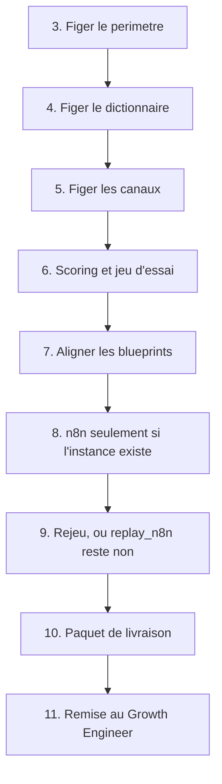
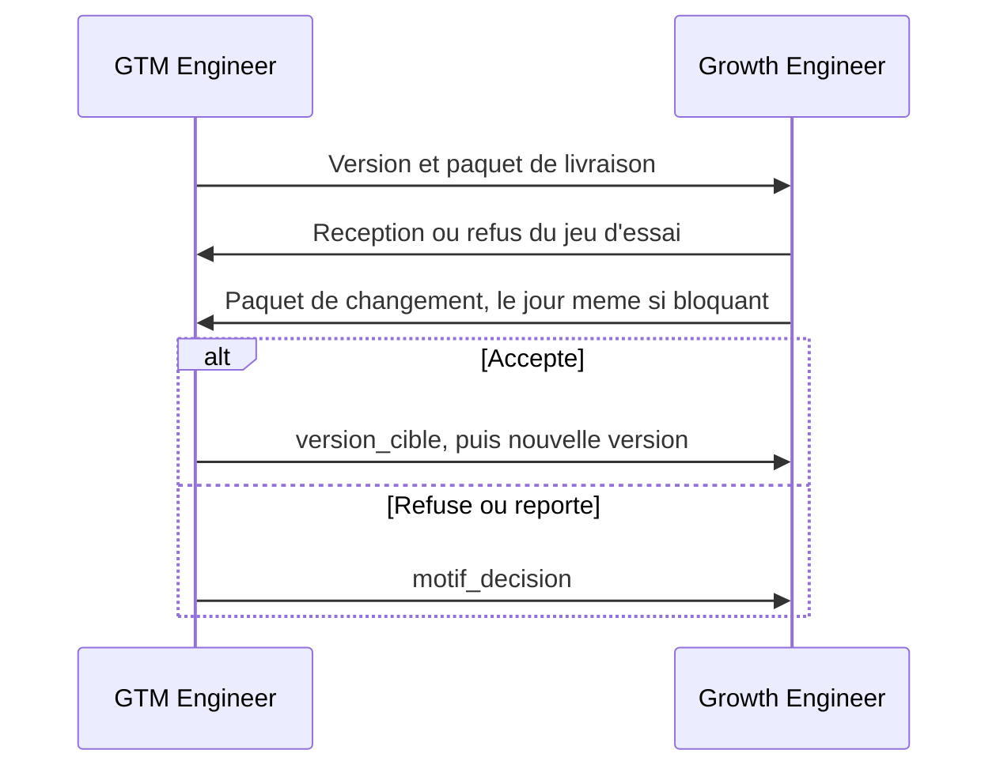

# Workflow opératoire du GTM Engineer

Version `2026.11.0`. Auteur : Didier Lioniello.

Le GTM Engineer **construit** la machine go-to-market. Il ne la fait pas tourner au quotidien : la cadence données, files et clôtures appartient au [Growth Engineer](growth-engineer.md).

Il publie des contrats et des plans de flux. Il ne déclare pas un flux exécuté s’il ne l’a pas été. Cette version est documentaire : les cases de mise en service du [paquet de livraison](../contrats/paquet-livraison.md) sont à `non`.

## Objet

Livrer une version unique de la machine : périmètre, dictionnaire, canaux, scoring, blueprints n8n, jeu d’essai, paquet de livraison. Tenir ensuite la file des changements sans laisser l’exploitation réécrire les règles dans le CRM.

## Entrées

| Entrée | Source | Usage |
| --- | --- | --- |
| Version précédente, ou l’absence de version | Dépôt | `2026.11.0` n’a pas de prédécesseur |
| Demande du Growth Engineer | [Paquet de changement](../contrats/paquet-changement.md) | Seul motif pour modifier une machine déjà remise, hors revue mensuelle |
| Bornes réelles d’activité, le jour où elles sont confirmées | Responsable de l’offre, par écrit | Case `perimetre_reel`. Tant qu’elles ne sont pas confirmées, les bornes documentaires restent un jeu de construction |
| Connecteur CRM, boîte email, outil d’acquisition | Choix explicite, nommés dans le paquet, secrets hors git | Interdits tant que `mise_en_service = non` |

## Sorties

| Sortie | Destinataire |
| --- | --- |
| Contrats et blueprints à la même version | Dépôt, puis Growth Engineer |
| Jeu d’essai dont l’arithmétique est écrite | Growth Engineer, pour refus ou réception |
| Paquet de livraison avec cases à jour | Growth Engineer |
| Décision `accepte`, `refuse` ou `reporte` sur chaque demande | Growth Engineer |
| Flux n8n dans l’instance | Uniquement quand l’instance existe. Le dépôt n’en contient pas le JSON |

## Outils

| Besoin | Outil de cette version | Remplacement |
| --- | --- | --- |
| Écrire les règles | Fichiers de ce dépôt | Aucun. La règle qui n’est pas dans le dépôt n’existe pas |
| Calculer le jeu | Contrat de scoring, à la main | Le même calcul, plus tard, dans un nœud Code |
| Automatiser | n8n | Colonne retenue. Pas d’autre orchestrateur dans cette version |
| Secrets | Coffre de l’instance n8n | Jamais le dépôt, jamais le journal |
| CRM, email, enrichissement, acquisition | Non choisis | Tout connecteur qui respecte le dictionnaire et le contrat de canaux |
| Journal des demandes | Support décrit dans le paquet | Tableur hors git tant que le support n’est pas choisi |

Le nom d’un éditeur de CRM ou d’email ne se glisse pas dans un flux « parce que c’est le plus courant ». On l’écrit dans le paquet le jour où il est choisi.

## Séquence de construction

Chaque étape se termine avant la suivante. Une version dont l’étape 6 échoue ne s’envoie pas.

1. Lire le [glossaire](../glossaire.md) et ce fichier jusqu’au bout. Confirmer le verbe du jour : construire, pas exploiter. **Outil :** dépôt.
2. Poser l’identifiant de version sur toutes les pièces en même temps. Format `AAAA.MM.N`. Cette publication est `2026.11.0`. **Outil :** dépôt.
3. Figer le [périmètre](../contrats/perimetre-offre.md) : pays acceptés, bornes d’effectif, exclusions. Ne pas y mettre de promesse commerciale ni de résultat. **Outil :** dépôt.
4. Figer le [dictionnaire](../contrats/dictionnaire-donnees.md) : champs, statuts, précédence lead puis enrichissement, durées. Un champ absent du dictionnaire n’entre dans aucun nœud. **Outil :** dépôt.
5. Figer le [contrat de canaux](../contrats/contrat-canaux.md). Laisser `branche = non` tant que l’outil réel n’est pas nommé et que les cases de garde ne sont pas à `oui`. **Outil :** dépôt.
6. Figer le [scoring](../contrats/contrat-scoring.md). Recalculer chaque fiche du [jeu d’essai](../contrats/jeu-essai.md) dans l’ordre, enrichissement considéré en échec. Écrire l’arithmétique dans le jeu d’essai. Un point d’écart : corriger la grille ou le jeu, puis recalculer tout le jeu. Ne pas publier une grille « à peu près ». **Outil :** contrat de scoring et jeu d’essai.
7. Aligner les trois [blueprints](../blueprints/capture-et-normalisation.md) sur ces contrats. Les listes de mots restent dans le contrat de scoring, pas recopiées dans le blueprint. **Outil :** dépôt.
8. Construire n8n seulement si une instance existe. Un workflow par canal, qui mappe vers le schéma commun puis appelle un seul sous-flux de décision. Les secrets d’accès restent dans le coffre. Aucun nœud d’envoi d’email dans cette version. Si l’instance n’existe pas : ne pas créer de JSON « pour plus tard » dans le dépôt, et laisser `replay_n8n = non`. **Outil :** n8n, ou arrêt explicite sans n8n.
9. Si l’étape 8 a eu lieu : rejouer le jeu sur une base sans `@exemple.test`, enrichissement forcé en échec. Conserver un compte-rendu d’identifiants d’exécution, sans message et sans adresse autre que `exemple.test`. Toute issue fausse : ne pas remettre la version, corriger le flux, rejouer. **Outil :** n8n et la table de test.
10. Remplir le [paquet de livraison](../contrats/paquet-livraison.md). `mise_en_service` reste `non` tant que `replay_n8n`, `perimetre_reel` et `conservation` ne sont pas tous à `oui`, avec au moins un canal `branche = oui` dans la même version. **Outil :** dépôt.
11. Remettre au Growth Engineer le numéro de version et le chemin du paquet. Aucun fichier de secret n’accompagne la remise. Attendre la réception ou le refus décrits dans son workflow. **Outil :** le canal habituel de travail de l’équipe, sans pièce jointe secrète.
12. À partir de cette remise, toute modification de mot, de seuil, de champ, de canal ou de nœud passe par une nouvelle version. Pas de correctif direct sur le flux que le Growth Engineer est en train d’exploiter. **Outil :** dépôt et n8n.

## Séquence du mardi

Créneau : mardi, 30 minutes. Le premier mardi du mois, ce créneau est remplacé par la revue de 60 minutes.

1. Lire les demandes ouvertes et le paquet du jour, y compris `aucun changement demande`. **Outil :** journal des demandes.
2. Pour chacune, écrire `decision`, `motif_decision` si ce n’est pas un accepté sans réserve, et `version_cible` si `accepte`. Un accepté sans version cible reste ouvert. **Outil :** schéma du paquet de changement.
3. Refuser toute demande qui est en réalité un écart d’exploitation (export oublié, clôture oubliée, champ déjà présent dans le message). Le motif dit de suivre le runbook du Growth Engineer. **Outil :** [workflow Growth](growth-engineer.md).
4. Si au moins une demande est acceptée : ouvrir la séquence de construction sur la version cible, le même jour pour un `bloquant`, sinon dans la file des versions. **Outil :** dépôt.
5. Ne pas éditer un seuil « en séance » dans n8n. La séance tranche. La version publie.

## Séquence du premier mardi

Soixante minutes, à la place du point de 30 minutes. Le Growth Engineer apporte le bilan mensuel.

1. Vérifier que les pièces de la version en vigueur portent encore le même numéro. **Outil :** dépôt.
2. Lire les contournements de plus de 5 jours ouvrés. Les traiter comme des versions à planifier, pas comme un mode de fonctionnement. **Outil :** revue mensuelle.
3. Décider l’ordre du mois suivant : `bloquant`, puis `genant`, puis `amelioration`. **Outil :** journal.
4. Vérifier les droits : seul le GTM Engineer édite les workflows n8n. Le Growth Engineer peut relancer une exécution, pas modifier un nœud. Si l’instance n’existe pas, noter `instance_absente`. **Outil :** n8n, écran des droits.
5. Vérifier qu’aucun commit du mois ne contient de secret ni de donnée personnelle. **Outil :** historique git.

## Incident bloquant

Le jour ouvré de la demande `bloquant` :

1. Confirmer le gel des files concernées. Personne n’écrit au lead pour « débloquer ». **Outil :** message au Growth Engineer.
2. Corriger par une nouvelle version, ou confirmer par écrit que la règle actuelle est voulue et que le symptôme vient d’un mauvais recalcul. **Outil :** dépôt ou contrat de scoring.
3. Si le flux en service est faux : le désactiver plutôt que le laisser produire des routes fausses. La désactivation est une version, notée dans le paquet. **Outil :** n8n.

## Cadence

| Rythme | Ce qui est dû |
| --- | --- |
| À chaque version | Séquence de construction, étapes 1 à 12 |
| Chaque jour ouvré | Rien, sauf demande `bloquant` de la veille non close |
| Mardi, 30 minutes | Séquence du mardi |
| Premier mardi, 60 minutes | Séquence du premier mardi, à la place des 30 minutes |
| Jour d’un bloquant | Séquence incident |

Le GTM Engineer n’ouvre pas la vue des files pour les vider. S’il le fait, il sort de son rôle et les comptes de la clôture deviennent faux.

## Contrôles qualité

Avant la remise, chaque ligne doit être vraie :

- Dictionnaire, canaux, scoring, périmètre, jeu d’essai, journal de clôture, paquet de changement, trois blueprints et paquet de livraison affichent la même version.
- Les 25 fiches du jeu d’essai ont été recalculées, et le fichier montre l’arithmétique, pas seulement la route.
- Aucun canal `branche = oui` tant que `mise_en_service = non`.
- `mise_en_service` n’est pas `oui` si `replay_n8n`, `perimetre_reel` ou `conservation` vaut `non`.
- Les blueprints ne contiennent pas une seconde copie des listes de mots.
- Le dépôt ne contient pas de jeton, de mot de passe, d’URL de webhook signée, ni d’adresse hors `@exemple.test`.
- Aucun nœud d’envoi n’est prévu dans les blueprints de cette version.
- Une demande acceptée possède une `version_cible`.

## Passation vers le Growth Engineer

Remettre :

1. Le numéro de version.
2. Le [paquet de livraison](../contrats/paquet-livraison.md), qui pointe vers le reste.
3. L’état réel de n8n : `replay_n8n = non` dans cette publication, donc aucune exécution n’est revendiquée.
4. Le gel éventuel des files, en cas d’incident.

Le Growth Engineer accuse réception seulement après son propre recalcul du jeu d’essai. Un silence n’est pas une réception.

## Retour attendu du Growth Engineer

| Retour | Ce que le GTM Engineer en fait |
| --- | --- |
| Refus de réception, avec la fiche du jeu qui diverge | Corrige la version. Ne demande pas d’exploiter « en attendant » |
| Clôture quotidienne en phase documentaire | Rien, tant que les cases restent à `non` |
| Paquet vide du mardi | `accepte`, motif `rien a publier`, pas de nouvelle version |
| Écart structurel | Décision écrite. Pas de conseil oral qui contredirait le contrat |
| Écart d’exploitation déguisé en demande | `refuse`, renvoi au runbook |
| Bilan du premier mardi | Ordre des versions du mois suivant |

## Garde-fous

- La machine classe et dépose dans une file. Elle n’écrit pas au lead et ne le relance pas.
- Le score est la grille publiée. Un modèle de langage ne choisit pas la route dans cette version.
- Une donnée fournie par le lead prime sur l’enrichissement.
- Les fiches déjà scorées ne sont pas recalculées lors d’une nouvelle version.
- Les secrets ne transitent pas par git, par le journal, ni par le paquet.
- Aucune donnée personnelle réelle n’entre tant que `mise_en_service = non`.

## Limites

- Les bornes France et 20–2000 sont le réglage documentaire de `2026.11.0`, pas une observation de marché.
- Les seuils 40 et 70 ne sont pas des probabilités de gain. Aucun taux n’est mesuré ici.
- Les blueprints ne sont pas des exports n8n. Les construire dans une instance est l’étape 8, et elle n’a pas été faite dans ce dépôt.
- La prise de rendez-vous et l’envoi d’une réponse ne font pas partie de cette version. Les ajouter est une nouvelle version, avec une case de garde en plus : brouillon revu par une personne avant tout envoi, et toujours aucune relance automatique.
